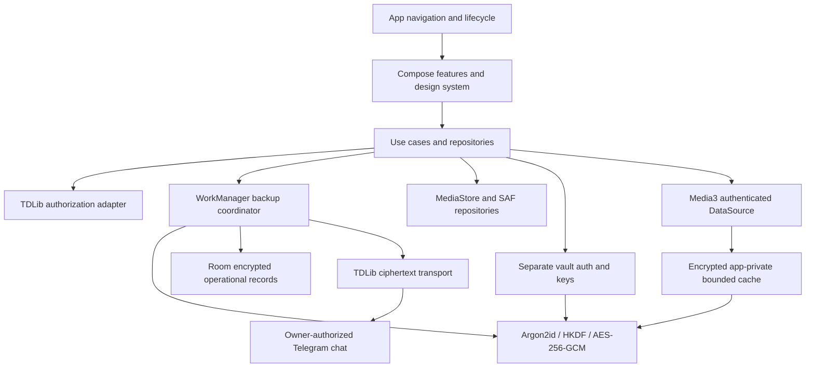

# TG Photos modular architecture

## Current compiled-source structure (compilation not yet run)

16 Gradle modules are declared: `:app`, `:core:model`, `:core:designsystem`, `:core:telegram`,
`:core:crypto`, `:core:backup`, `:core:database`, `:core:media`, `:core:cache`, `:core:testing`,
`:feature:auth`, `:feature:photos`, `:feature:albums`, `:feature:files`, `:feature:vault`, `:feature:settings`.

The app is the composition root. Features depend on model/designsystem and non-sensitive preview fixtures.
Auth uses country metadata from telegram. Core transport, crypto/cache and operational modules are isolated
contracts/foundations; they are **not wired into a functioning backup application**. No credentials, real media,
sessions or cloud encryption keys exist in Phase 1. Room schema has opaque IDs and encrypted envelopes only;
no database is opened. BackupWorker always fails unavailable and is never scheduled.

## Target runtime graph

This graph describes subsequent phases, not current connected behavior.

## Contracts and invariants

- TDLib updates drive authoritative authorization state, including email and email-code branches.
- Storage chat selection requires explicit account/user consent and feasibility checks.
- Credentials/session database stay in app-private storage; protect its encryption key using Keystore.
- Generate random 256-bit root keys; Argon2id derives an unlock key with unique salt and calibrated limits.
- Wrap root separately under passphrase and offline recovery keys. Keystore is a local convenience layer,
  never the only way to restore on a second device.
- Separate scoped file/manifest/cache/vault keys with HKDF labels. Fresh file keys per file/version.
- Bind protocol/schema version, file/version ID, chunk index/length and manifest context to AEAD associated data.
- Transport gets opaque names and ciphertext only. Authenticate before releasing any media bytes.
- Upload all encrypted chunks, verify authoritative transport completion, commit encrypted manifest last.
- Keep resumable checkpoints encrypted; handle cancellation, duplicates, missing messages and FloodWait.
- Independent full remote restore with authenticated manifest/chunks, matching byte count/hash and exact version
  is required before offering device deletion. Android deletion consent remains separate.
- Decode thumbnails only in memory; no plaintext disk cache, shared-storage staging or automatic crash upload.
- Explicit user-approved sharing/export uses temporary grants and tracked cleanup; never implicit provider access.

Manual dependency injection is sufficient for P1. Introduce repositories/ViewModels when live asynchronous
state is added, using lifecycle-aware Flow collection and fail-closed error states. Do not add a remote backend.

The current RestoreEvidence value object checks eligibility invariants, not the provenance of a proof.
A future trusted restore-verification service must produce/version-bind evidence from authenticated downloads;
the UI must never synthesize it. No current code performs or authorizes an Android device deletion.
